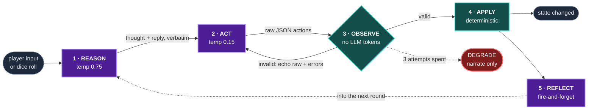

<div align="center">

# 🎲 KRENKO'S WAY

### A visual-novel adaptation of the D&D 5e starter module *Krenko's Way* (Ravnica).

An LLM plays the Dungeon Master. You type what you want to do, and the game responds
in prose — with the world state changing accordingly.

<br/>


</div>

---

## About

A browser game built with PixiJS and TypeScript, in the style of a visual novel. There is no
backend and no dialogue tree — the Dungeon Master's replies are generated at runtime.

You type anything you like, for example *"I grab the half-elf by the collar and ask who paid
him."* The DM answers in prose, and where the story calls for it, the game changes state: dice
get unlocked, items are added to your pack, HP moves, the background swaps, a 3-round brawl
starts, an NPC's opinion of you shifts.

Every one of those state changes is requested by the model as a structured action, then checked
by a deterministic TypeScript layer before it is applied. The model proposes; the engine decides.

---

## Quick start

```bash
npm install
cp .env.example .env        # then paste your key
npm run dev                 # → http://localhost:5179/dev/2d_game_template/
```

**Config** (`.env`):

```ini
VITE_LLM_PROVIDER=ark                      # or: ollama
VITE_ARK_API_KEY=your_ark_api_key_here
VITE_ARK_MODEL=doubao-seed-2-0-lite-260215
# VITE_ARK_API_KIND=responses              # /chat/completions (default) or /responses
```

Running fully offline:

```bash
ollama serve && ollama pull qwen2.5:9b
# .env → VITE_LLM_PROVIDER=ollama
```

Both providers go through a single stateless multi-message API, `chatMessages()`, with separate
temperature and token budgets per phase. It is stateless so that a retry cannot pollute hidden
conversation history — re-prompting stays predictable.

> Open DevTools and watch the `[ReAct]` logs. They print the thought, reply, actions,
> observations, retries and reflection for each turn.

---

## Project structure

```
src/
├── ai/                      # provider layer — one stateless contract, two backends
│   ├── LLMClient.ts         #   dispatch: chatMessages()
│   ├── ArkClient.ts         #   Volcengine Ark (chat/completions + /responses)
│   └── OllamaClient.ts      #   local models
├── game/
│   ├── MainScene.ts         # visual-novel UI: dialogue, dice, footer HUD
│   ├── data/                # module content: blocks, items, battles, NPCs
│   └── systems/
│       ├── AIDirector.ts    # prompt assembly + deterministic side effects
│       └── react/           # the ReAct loop
│           ├── ReActLoop.ts       # attempts, re-prompting, degradation, reflection
│           ├── ActionRegistry.ts  # action catalog + whitelist validation + merge
│           ├── Prompts.ts         # per-phase instructions
│           └── ReActTypes.ts      # the contract
├── engine/  audio/  utils/
└── platform/Bridge.ts       # host page communication
```

**Controls:** type in the box, `Enter` to send. Click the dice to roll when they light up.

---

## How one turn works

This started as a small exercise: let the model propose anything it wants, but keep it from
breaking the game state. One way to do that is to give the model a narrow job — write the prose
and the proposed actions, nothing else — and put a plain TypeScript layer between it and the game.



🟪 LLM call · 🟩 ordinary TypeScript. Three model calls per turn, and one place where the
decision is made.

---

## The loop in detail

### ① Reason — *what do I think, what do I say?*

The model writes two things in one shot:

- `thought` — internal reasoning that steers the machine actions. Kept out of the dialogue box;
  printed to the console only.
- `reply` — the actual prose the player reads.

Keeping them separate helps: when narration and machine fields share one output, the model tends
to write a good paragraph and then append `{"next": null, "dice": {}}` just to satisfy the schema.
Splitting them lets the prose stay prose and the action stay precise.

Roll rules are handled in the prose prompt rather than after the fact — if a check is coming, the
reply is asked to **stop at the moment of uncertainty** and not narrate an outcome before the dice
have decided it.

### ② Act — *turn that reply into machines*

The act prompt receives `thought` and `reply` **verbatim** and produces nothing but an action
array. It is asked not to write new narration or move the story along; its job is to encode what
the reply already committed to.

Eight action types:

| action | what it does | validated against |
|---|---|---|
| `dice` | request a six-attribute check | 力量/敏捷/体质/智力/感知/魅力, DC 5–25 |
| `battle` | start a 3-round prefab combat chain | the scene's slot whitelist |
| `hp` | heal / damage | clamped to ±15 |
| `item` | pack add / remove | item ID enum |
| `flag` | record a discovered clue | truncate at 40 chars |
| `scene_visual` | swap the background art | per-block visual keys |
| `transition` | move to another story block | `transitions` whitelist |
| `npc_effect` | shift an NPC's opinion | 4 NPCs, relation −2…2 |

### ③ Observe — *checking the proposal*

Two kinds of pushback:

**Hard errors → re-prompt.** Unknown block ID, a battle slot that doesn't exist in this scene,
a non-existent item, or `dice` and `battle` in the same turn. The engine sends back **the model's
own raw output** along with the specific violations, and asks again. Up to 3 times.

**Soft corrections → fixed quietly.** A DC out of range is clamped. An HP delta of −200 becomes
−15. A `dice` action fired mid-combat-chain is dropped, since the chain is already running. The
model isn't told about these; they're logged for the reflection step.

> Retries reuse the **same reason-phase output**. An act-phase failure re-runs *only* the act
> phase, so the reply the player is already reading doesn't change underneath them.

### ④ Apply — *deterministic, and once*

HP clamping, pack overflow (8 slots), NPC relations, scene-visual timing gates, dice consumption,
combat-chain advancement, transition + read-aloud suppression. No model involvement. This is where
`AIResponse` becomes actual game state.

### ⑤ Reflect — *a short self-review*

After the turn lands, a **fire-and-forget** call reviews what happened — including the engine's
soft corrections, which the model otherwise never sees — and returns a brief critique plus
`nextFocus` points. These are injected into the **next** turn's reason phase.

The reflection is awaited before the next round starts, so "the previous reflection feeds the next
round" holds rather than races. A block transition bumps an epoch counter and discards any
in-flight reflection, so a critique written in the tavern doesn't carry into the dungeon.

---

## When things go wrong

| failure | response |
|---|---|
| Malformed JSON | re-prompt with raw output + parse error (×3) |
| Illegal action | re-prompt with raw output + the exact illegal fields (×3) |
| 401 / 403 / 400 / auth | fail immediately — re-prompting can't fix an API key |
| Timeout / 5xx / jitter | one extra retry, 500 ms backoff, then give up |
| 3 attempts exhausted | degrade: narrate only, zero actions, system notice, input re-enabled |

The last row is the one that matters most. The state machine doesn't lock up; a bad model turn
costs one turn of mechanical effects and nothing more — no frozen input, no half-applied state.

Retries are kept out of the player's view: intermediate output and diagnostics go to the console
with a `[ReAct]` prefix. They are deliberately not sent to the narrate channel, which queues
messages and would reorder the transcript.

---

## Memory

| tier | scope | mechanism |
|---|---|---|
| **Rolling window** | within a story block | 50-message transcript cap, last 12 rendered into the prompt |
| **Reflection** | last turn | silent self-critique injected into the next reason phase |
| **Summaries** | across blocks | LLM-compressed digest, carried in `gameProgress` |

Short-term detail, immediate self-correction, long-term coherence. Across 15 story blocks each
of the three covers something the others don't.

---

## The module

What's implemented from *Krenko's Way*:

- **15 story blocks** — from the rainy rendezvous outside Sawtooth Prison to the ruined Selesnya
  granary, with a three-way investigation (informants / rumor-mongering / the undercity)
  converging on Krenko's hiding place.
- **9 prefab combat chains**, 3 attribute checks each — the sewer patrol, the Tin Street tail,
  the Forge-Street welcome party. Each is gated to its own scene, max 2 per scene.
- **4 tracked NPCs** with relations from −2 to +2, feeding into the ending.
- **Six attributes only.** No skill list, no classes — keeping DCs legible for both the player
  and the model.
- **Original read-aloud text**, kept verbatim. The AI receives a *summary* instead, so the
  module's prose stays as written and the token cost stays low.

---

<div align="center">
<sub>Built on the <b>VAG</b> playground · PixiJS 8 · TypeScript · Vite · 100% client-side</sub>
</div>
